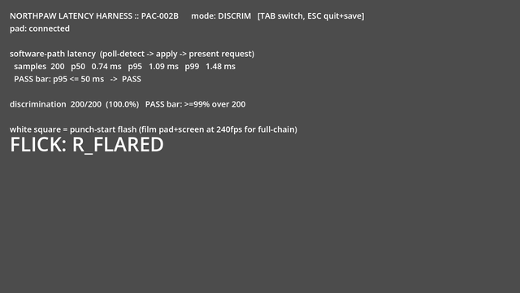

# PAC-010 Godot test session — 2026-09-18

PAC-010 is **DOING**, under active NDL-008. Godot AI MCP was installed,
connected to the real editor, and used to run and exercise the available
latency harness. The Two Hands milestone is not complete.

## Verified results

| Check | Result | Evidence |
| --- | --- | --- |
| Live editor and rendered game control | Passed: Godot 4.7.2, NVIDIA RTX 5090, compatibility renderer | [Recovered launch](PAC-010-20260918/recovered-run.json) |
| Ten-sector prompt discrimination | 200/200, all ten sectors covered, five batches of 40 | [Summary and hashes](PAC-010-20260918/summary.json) |
| Rendered software timing, 120 FPS cap, VSync off | p50 0.736 ms; p95 1.093 ms; p99 1.480 ms | [Raw CSV](PAC-010-20260918/latency_log.csv) |
| Tab switches to discrimination mode | Passed through injected key events | [First batch](PAC-010-20260918/batch-1.json) |
| Escape saves and exits | Passed: 200 discrimination rows, 200 latency rows, three summaries | [Save event](PAC-010-20260918/save-and-exit.json), [stopped state](PAC-010-20260918/after-save.json) |
| Threshold, held-stick suppression, neutral rearming after addon recovery | Passed: sample counts `[0,0,1,1,1,2,2]` | [Fresh smoke test](PAC-010-20260918/recovered-smoke.json) |
| Existing prototype regression suite | 836 checks, 800 synthetic direction samples, no failures | [Godot test log](PAC-010-20260918/prototype-tests.log) |



Input was injected through Godot's input system. Timing begins when the harness
detects the vector and ends at `RenderingServer.frame_post_draw`. These results
exclude physical controller transport, event-to-poll delay, display scanout and
pixel response. They are neither physical latency measurements nor human
playtester data. No game-feel, counter-rate spread or gassed-frequency result was
claimed. PAC-002B remains TODO and OGM-002 remains PACED_REQUIREMENT.

## Reproduced defects and missing acceptance

1. **Controller device selection:** `engine/latency_harness/main.gd` polls device
   0 only. Identical injected right-stick flicks on devices 1, 2 and 3 produced
   zero samples; device 0 produced one. The runtime lists the Razer Wolverine at
   devices 1 and 2, a separate XInput entry at 0, and the Keychron at 3.
   This reproduces a concrete cause of ignored nonzero-device input; it does
   not prove which hardware interface emitted the earlier physical flicks.
   [Device inventory](PAC-010-20260918/devices.json),
   [input reproduction](PAC-010-20260918/device-test-before.json).
2. **Root project does not launch:** its main scene is `res://main.tscn`, which
   is absent. The working project for this session is `engine/latency_harness/`.
   [Failure log](PAC-010-20260918/root-launch.log).
3. **Combat milestone is unbuilt:** PAC-005 through PAC-009 are TODO; the
   repository contains tuning data, design documents, input prototypes and
   latency scenes, but no assembled Two Hands combat build. PAC-010's six hard
   blockers and original five-playtester DoD were preserved.
4. **Repository checks are already red:** the local PACER validator reports
   three missing paths (OVR-026, OVR-038, OVR-039). The Python suite ran 11 tests
   with 21 failures and one import error, covering legacy authority/import-path
   mismatches and register expectations. Gameplay tests passing do not resolve
   these failures. [Validator](PAC-010-20260918/pacer-validation.log),
   [Python suite](PAC-010-20260918/python-tests.log).

## Installation and recovery

The supplied `godot-ai-plugin/addons/godot_ai` 3.2.1 package was copied into the
harness, enabled in its project settings, and its runtime helper autoload was
registered by Godot. Godot upgraded the project feature marker to 4.7 when saving.
The matching `godot-ai==3.2.1` server was installed with the existing uv/Python
and a repository-local cache; it listens on loopback HTTP 8000 and WebSocket
9500. Telemetry is disabled for the launched processes. The Codex configuration
contains the local MCP URL, with the previous configuration backed up beside it.
This session used the real MCP protocol through `tools/godot_mcp.py`; no Codex
restart was needed to exercise it.

A self-update subsequently attempted a 4.1.0 migration and failed to swap the
addon directory on Windows. Its tree, activation state and log were preserved
under `.pacer/godot-testing/failed-v4-*`. Only the editor launched for these tests
was stopped. The supplied 3.2.1 addon was restored byte for byte, the editor
restarted, and launch/input control freshly verified. The update failure log is
[retained](PAC-010-20260918/editor-before-recovery.log). Final state: editor open,
MCP ready, game stopped. Do not treat the failed v4 migration as installed.

The first 200-prompt eval exceeded the MCP helper's eight-second execution
budget. Its failed response is retained as `200-prompts.json`; the successful
run used five separately verified 40-prompt batches after restarting the game.
An unsupported screenshot parameter and the initial relative log-path error
were corrected; neither was counted as a passing test.

PACER MCP onboarding found legacy schema/history conflicts; migration preview
failed with `Cannot add new scope to absorbed history`. Changes therefore used
single-writer atomic serialization in the existing canonical schema. Baseline
register copies are preserved in `.pacer/pac010-baseline/`. No rows, blockers,
definitions of done, or failed evidence were deleted. No task was marked DONE,
no requirement advanced, and no commit was made.

## Reproduction entry points

`tools/start_godot_testing.ps1` launches the editor and a compatible local server.
Its `-ServerOnly` mode reuses an already running compatible server. The client
accepts `--tool`, `--args-file`, and `--output`; all five batch argument files are
retained alongside their responses. Start a fresh harness before replaying batch
1, then replay batches 2–5 in order. The runtime SDK can be accessed without a
new project environment:

```powershell
$env:UV_CACHE_DIR = Join-Path (Get-Location) '.uv-cache'
$env:UV_TOOL_DIR = Join-Path (Get-Location) '.uv-cache/tools'
& "$env:USERPROFILE/.local/bin/uv.exe" tool run --offline --python .venv/Scripts/python.exe --from godot-ai==3.2.1 python tools/godot_mcp.py --tool editor_state
```

Integration references: [Godot AI upstream](https://github.com/hi-godot/godot-ai)
and [official Codex MCP configuration](https://developers.openai.com/codex/mcp/).
