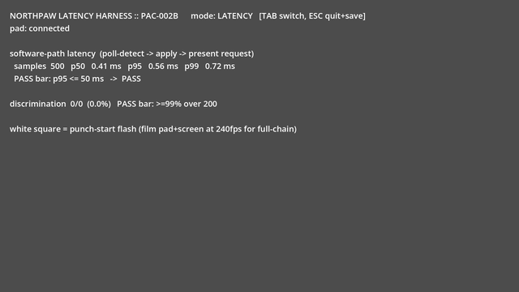

# Continued PAC-010 playtesting

Live tests used Godot 4.7.2, Godot AI 3.2.1, and the rendered
`engine/latency_harness` project at source commit `ac99ffb`. PAC-010 remains
**DOING** under **NDL-009**. No gameplay source or combat tuning changed.

## Results

| Test | Observed result | Evidence |
| --- | --- | --- |
| Sector centers and points 0.5 degrees inside each boundary | 30/30 correct | [sector edges](PAC-010-continuation/sector_edges.json) |
| Activation and neutral rearming thresholds | 0.599 rejected; 0.600 and 0.601 accepted; 0.251 did not rearm, 0.250 did | [thresholds](PAC-010-continuation/threshold_hysteresis.json) |
| Repeated input capture at 120 FPS | 600/600 punches, all expected directions, approximately 30 seconds of stimulus | [last batch](PAC-010-continuation/soak-10.json), [summary](PAC-010-continuation/summary.json) |
| Rolling buffer and export | HUD retained 500 samples; exported CSV retained all 600 | [verification](PAC-010-continuation/export-verification.json), [CSV](PAC-010-continuation/soak-latency-log.csv) |
| Software timing after the repeated-input run | Rolling-window p95 0.564 ms; excludes physical/controller/display latency | [raw samples](PAC-010-continuation/soak-10.json) |
| Simulation regression gates | 14/14 passed | [test log](PAC-010-continuation/simulation-tests.log) |

## Reproduced input findings

1. **Diagonal classification depends on axis delivery timing.** Deliberately
   separating the X and Y events by two rendered frames produced the wrong
   direction in 12/16 cases. For example, a 36-degree right flared gesture
   became `R_HOOK` when X arrived first. A 45-degree gesture became
   `R_STRAIGHT` when Y arrived first. These are controlled stress cases;
   12/16 is not a measured hardware error rate. The same final vectors work
   when their axis events arrive together. [Exact cases](PAC-010-continuation/split_axis_delivery.json).
2. **A pulse can disappear between polls.** A nonzero stick vector followed by
   neutral in the same frame produced zero punches. Holding the same vector
   across three frames produced one. This identifies a polling blind spot,
   not its frequency on physical hardware. [Reproduction](PAC-010-continuation/subframe_pulse.json).
3. **Held Tab changes mode and clears collected discrimination counts.** A
   successful 1/1 trial was reset to 0/0 and switched to LATENCY by an echo
   key event from the same held key. [Data-loss reproduction](PAC-010-continuation/echo-data-loss.json).
4. **The harness accepts slow excursions as flicks.** A continuous ramp
   lasting 1.358 seconds still generated a punch. The separate prototype has
   a provisional 120 ms flick limit; this harness does not enforce one.
   The difference must be resolved before comparing their discrimination
   results. [Slow ramp](PAC-010-continuation/slow_ramp.json).
5. **The white timing marker lasts two rendered frames.** This was observed
   at 30, 60 and 120 FPS. Its duration therefore changes with frame rate;
   `flash_frames = 3` is decremented during the detection frame.
   [Frame observations](PAC-010-continuation/flash_frames.json).

The previously reproduced device-0-only input issue also remains in source.
This session collected evidence rather than modifying those input rules.

## Reference simulation

Two full runs used 120 deterministic seeds per skill tier, three tiers per
boss: **720 simulated fights**, separate from Godot runtime testing and from
human playtesters. Both runs returned FINDINGS.

| Metric | Cassidy Vane | Deshawn Vaughn |
| --- | --- | --- |
| Novice runs reaching first DROP | 6/120 | 1/120 |
| First-DROP median among those runs | 29.3 s | 23.4 s |
| Skilled/novice mean counter-rate ratio | 3.61x | 4.43x |
| Median-tier adaptation flags per fight | 0.6 | 0.5 |
| Median-tier gassed time | 0% | 0% |

The first-DROP medians exclude the many runs without a DROP. They must not be
read as typical novice completion times. Adaptation remains below the 1–3
flags/fight band. The ratio compares model-tier means; it is not PAC-010's
human-playtester p90/p10 measurement. Tuning was left unchanged.

Raw results: [Vane](PAC-010-continuation/vane-metrics-120.txt),
[Vaughn](PAC-010-continuation/vaughn-metrics-120.txt).
An initial smaller Vane run with 20 seeds/tier is also retained; its counter-rate
ratio was 2.99x, illustrating the sensitivity of this summary to the seed sample.

## Evidence and remaining work

Each runtime case includes the actual MCP arguments and response. Input was
injected through Godot's input system, with the game rendering on the GPU.
The 600-input run used ten batches of 60 to stay within the MCP eval budget.
The prior user-data CSV was copied before export. Escape export and clean stop
were checked. The editor remains open with MCP connected; the game is stopped.

An initial temporary test script mixed spaces with the MCP wrapper's tabs and
failed compilation. The failed response and arguments were retained. Converting
indentation to tabs passed Godot's parser; the paused game was restarted before
the successful run. No failed invocation was counted as a gameplay pass.

The incoming commit `ac99ffb` retained the earlier test artifacts but replaced
their register entries and assigned NDL-008 to the absorbed combat simulator.
Its canonical history was preserved. This continuation uses NDL-009; the older
report's NDL-008 statement describes that earlier workspace state. PAC-010's
original DoD and blockers remain intact, and no task or requirement was closed.
Legacy PACER MCP migration remains unavailable as recorded in the preceding
session, so this continuation used validated serialization and atomic writes
in the existing schema. The local validator still reports its same three
missing paths: OVR-026, OVR-038 and OVR-039.

The next input work is device selection, partial-axis classification, event
capture between frames, and ignoring key-repeat events for mode changes.
The Godot combat build and five-human-playtester milestone evidence are still
absent. These tests do not establish physical latency or game-feel acceptance.
